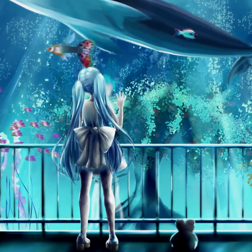

# Next Music Themes

Темы и аддоны для [Next Music](https://github.com/Web-Next-Music/Next-Music-Client) —
клиента Яндекс Музыки с поддержкой тем.

## Установка

В PowerShell, откроется меню выбора:

```powershell
irm https://raw.githubusercontent.com/tune-music/next-music-themes/main/install.ps1 | iex
```

Или сразу нужное, через запятую:

```powershell
& ([scriptblock]::Create((irm https://raw.githubusercontent.com/tune-music/next-music-themes/main/install.ps1))) -Name 'Night of Knights','Discord Lyrics Status'
```

Установщик сам ставит всё, что нужно теме или аддону:

- закрывает Next Music и кладёт папку в `%APPDATA%\next-music\Addons` вместе с картинками;
- у тем включает старый интерфейс Яндекс Музыки через `experiments.override`;
- отключает другие включённые темы, чтобы они не конфликтовали (аддоны не трогает);
- заменяет старую установленную копию и её отключённый двойник;
- снова запускает Next Music.

Вручную: скопируйте папку темы или аддона в `%APPDATA%\next-music\Addons\` и перезапустите
клиент. Имена папок не меняйте: по ним темы загружают свои картинки.

## Отдельные репозитории

Для магазина Next Store каждая тема и Discord Lyrics Status лежат ещё и в своём репозитории.
Основная разработка идёт здесь, отдельные репозитории обновляются отсюда.

- [night-of-knights-theme](https://github.com/absolute2007/night-of-knights-theme)
- [cyber-glitch-theme](https://github.com/absolute2007/cyber-glitch-theme)
- [everything-will-freeze-theme](https://github.com/absolute2007/everything-will-freeze-theme)
- [kokou-no-sousei-theme](https://github.com/absolute2007/kokou-no-sousei-theme)
- [discord-lyrics-status](https://github.com/absolute2007/discord-lyrics-status)

## Темы

| | Тема | |
| --- | --- | --- |
|  | [Night of Knights](themes/Night%20of%20Knights) | Сакуя под луной из osu! карты, глаза светятся от музыки |
|  | [CYBER GLITCH](themes/CYBER%20GLITCH) | Киберпанк, глитч-арт и электро-циан |
|  | [EVERYTHING WILL FREEZE](themes/EVERYTHING%20WILL%20FREEZE) | Чёрно-белая тушевая иллюстрация |
|  | [Kokou no Sousei](themes/Kokou%20no%20Sousei) | Кристальное стекло по арту Kokou no Sousei |
|  | [Frutiger Aero](themes/Frutiger%20Aero) | Светлое небо, трава, глянцевое стекло и пузыри |
|  | [Aquarium](themes/Aquarium) | Живой аквариум с обложки sqwore, бирюзовое стекло |

Все темы с liquid glass, логотипом в заголовке окна и старым интерфейсом «Моей волны».
Одновременно включайте одну тему.

## Аддоны

| | Аддон | |
| --- | --- | --- |
|  | [Discord Lyrics Status](addons/Discord%20Lyrics%20Status) | Текущая строка песни в статусе Discord |
| | [Scrobbler](addons/Scrobbler) | Скробблинг в ListenBrainz с офлайн-очередью |

## Отключение

Переименуйте папку в `Addons`, добавив `!` в начало (например `!Night of Knights`),
и перезапустите Next Music. Так же отключает дополнения и сам клиент.
