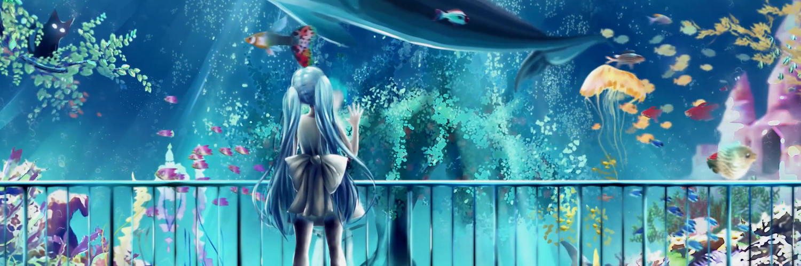

# Aquarium



Тема для [Next Music](https://github.com/Web-Next-Music/Next-Music-Client) по обложке
sqwore — «Аквариум»: девочка у стекла огромного аквариума, над ней проплывает кит.

- Живой фон: анимированная версия обложки на весь экран и в центральном блоке, бесшовная петля 60 секунд.
- Цвет приглушён в холодную бирюзу, как в глубине аквариума; белый текст читается на любом участке.
- Бирюзовое liquid glass: сайдбар и плеер преломляют воду по краям, меню, очередь и текст песни в стекле.
- Пузырьки медленно поднимаются по фону.
- Старый интерфейс: классическая «Моя волна» и плеер на всю ширину окна.
- Логотип и название темы в заголовке окна, полноэкранный плеер на фоне того же аквариума.

## Установка

Одной командой в PowerShell:

```powershell
& ([scriptblock]::Create((irm https://raw.githubusercontent.com/absolute2007/next-music-themes/main/install.ps1))) -Name 'Aquarium'
```

Установщик закроет Next Music, положит тему в `%APPDATA%\next-music\Addons\Aquarium`
вместе с видео и флагами старого интерфейса, отключит другие темы и запустит клиент снова.

Вручную: скопируйте папку `Aquarium` в `%APPDATA%\next-music\Addons\` и перезапустите
Next Music. Имя папки не меняйте: по нему загружается видео темы.

Чтобы выключить тему, переименуйте папку в `!Aquarium` и перезапустите клиент.

## Производительность

Видео 1080p, 30 кадров/с, без звука (~20 МБ). Когда окно свёрнуто, оно ставится на паузу;
копия для полноэкранного плеера декодируется только пока он открыт.

## Файлы

| Файл | Что делает |
| --- | --- |
| `style.css` | бирюзовая палитра, стекло, пузыри, раскладка старого интерфейса |
| `script.js` | сцены с видео и их синхронизация, пузыри, преломление, логотип, оверлейный скроллбар |
| `experiments.override` | включает старый интерфейс (`WebNextNewWaveTab = "default"` и связанные флаги) |
| `assets/bg.mp4` | анимированный фон |
| `assets/poster.jpg` | первый кадр, пока видео грузится |
| `icon.png`, `logo.png`, `banner.png` | иконка, логотип и баннер темы |

Обложка принадлежит sqwore и её автору; анимация взята из обоев Wallpaper Engine «eve sqwore».
