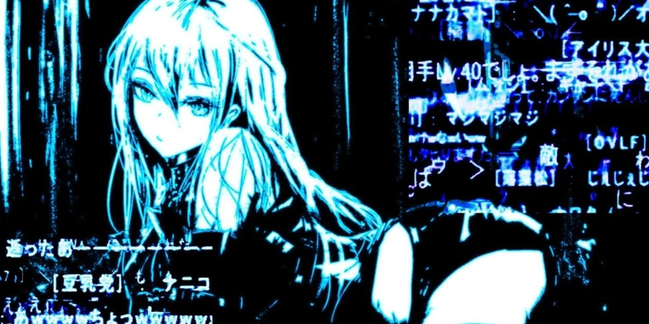

# CYBER GLITCH



Киберпанк-тема для [Next Music](https://github.com/Web-Next-Music/Next-Music-Client):
глитч-арт, обсидиановое стекло и электро-циановые акценты.

- Глубокий чернильно-синий фон с неоново-циановыми акцентами (`#00e5ff`).
- Liquid glass: сайдбар, центральный блок и плеер преломляют фон по SVG-карте нормалей.
- Логотип и название `CYBER GLITCH` по центру заголовка окна.
- Классическая «Моя волна» с киберпанк-артом и неоновой кнопкой Play.
- Двухцветный регулятор громкости: циан для выставленного уровня, матовая подложка для остального.
- Ровные круглые кнопки закрытия в очереди, тексте песни и модальных окнах.
- Полноэкранный плеер, меню, модальные окна и профиль в общей палитре.

## Установка

Одной командой в PowerShell:

```powershell
& ([scriptblock]::Create((irm https://raw.githubusercontent.com/absolute2007/next-music-themes/main/install.ps1))) -Name 'CYBER GLITCH'
```

Установщик закроет Next Music, положит тему в `%APPDATA%\next-music\Addons\CYBER GLITCH`
вместе с картинками и флагами старого интерфейса, отключит другие темы и запустит клиент снова.

Вручную: скопируйте папку `CYBER GLITCH` в `%APPDATA%\next-music\Addons\` и перезапустите
Next Music. Имя папки не меняйте: по нему загружаются картинки темы.

Чтобы выключить тему, переименуйте папку в `!CYBER GLITCH` и перезапустите клиент.

## Файлы

| Файл | Что делает |
| --- | --- |
| `style.css` | палитра, стекло, классическая «Моя волна», полноэкранный плеер |
| `script.js` | фильтр преломления и логотип в заголовке окна; снимается без следа при отключении |
| `experiments.override` | включает старый интерфейс (`WebNextNewWaveTab = "default"` и связанные флаги) |
| `assets/bg.jpg` | фон |
| `assets/vibe.jpg` | арт «Моей волны» |
| `assets/icon.png`, `assets/logo.png` | иконка и логотип |
