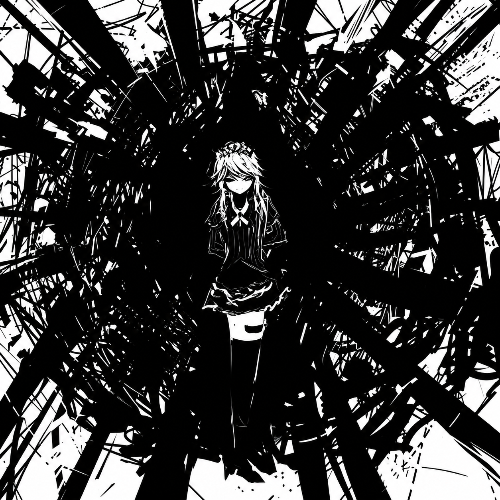

# EVERYTHING WILL FREEZE



Чёрно-белая тема для [Next Music](https://github.com/Web-Next-Music/Next-Music-Client):
тушевая иллюстрация, нейтральная палитра и преломляющие стеклянные панели.

- Строгая чёрно-белая палитра, квадратные обложки, компактные списки.
- Liquid glass: сайдбар, центральный блок и плеер с одним материалом стекла.
  Края преломляют фоновую иллюстрацию, текст и кнопки не искажаются.
- Классическая «Моя волна»: иллюстрация на весь блок под штатными кнопками, без подписи.
- Очередь и текст песни на общей стеклянной панели с отдельной кнопкой закрытия.
- Логотип и название темы по центру заголовка окна, кнопка сворачивания сайдбара скрыта.
- Поиск, коллекция, альбомы, плейлисты и контекстные меню в общей палитре.
- Обложки треков сохраняют свои исходные цвета.

## Установка

Одной командой в PowerShell:

```powershell
& ([scriptblock]::Create((irm https://raw.githubusercontent.com/absolute2007/next-music-themes/main/install.ps1))) -Name 'EVERYTHING WILL FREEZE'
```

Установщик закроет Next Music, положит тему в `%APPDATA%\next-music\Addons\EVERYTHING WILL FREEZE`
вместе с картинками и флагами старого интерфейса, отключит другие темы и запустит клиент снова.

Вручную: скопируйте папку `EVERYTHING WILL FREEZE` в `%APPDATA%\next-music\Addons\` и перезапустите
Next Music. Имя папки не меняйте: по нему загружаются картинки темы.

Чтобы выключить тему, переименуйте папку в `!EVERYTHING WILL FREEZE` и перезапустите клиент.

## Изображение

`assets/everything-will-freeze.png` — 1254 × 1254, улучшенная нейросетью версия исходника.
`assets/original.jpg` — исходник 447 × 447 без изменений. Улучшение делает линии чётче,
но может менять мелкие детали. Текст запроса лежит в `IMAGE-PROMPT.txt`.

Чтобы вернуть исходник, замените `everything-will-freeze.png` на `original.jpg`
в первой переменной `style.css`.

## Файлы

| Файл | Что делает |
| --- | --- |
| `style.css` | палитра, стекло, классическая «Моя волна», очередь и текст песни |
| `script.js` | фильтр преломления и логотип в заголовке окна; снимается без следа при отключении |
| `experiments.override` | включает старый интерфейс (`WebNextNewWaveTab = "default"` и связанные флаги) |
| `assets/everything-will-freeze.png` | фоновая иллюстрация |
| `assets/original.jpg` | исходник иллюстрации |
| `assets/icon.png`, `assets/logo.png` | иконка и логотип |
