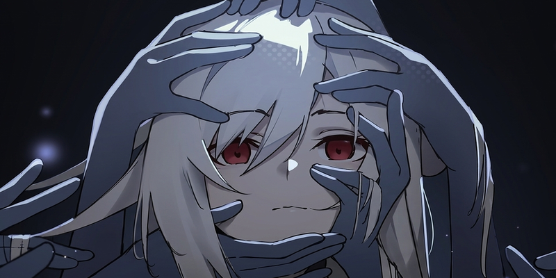

# Kokou no Sousei



Тёмная тема для [Next Music](https://github.com/Web-Next-Music/Next-Music-Client)
по арту Kokou no Sousei: кристально прозрачное стекло и палитра, снятая прямо с арта.

- Палитра взята из иллюстрации, арт виден сквозь центральный блок.
- Crystal liquid glass: три парящие прозрачные панели с кристальной кромкой,
  без мутной заливки и без подсветки за курсором.
- Классическая «Моя волна» широким баннером, без нового колеса волны.
- Классический трекбар: аккуратная полоса прогресса, регулятор громкости без мигания.
- Логотип и `KOKOU NO SOUSEI` по центру заголовка окна.
- Ровные круглые кнопки закрытия в очереди, тексте песни и модальных окнах.
- Очередь и текст песни в полноэкранном плеере на одном стеклянном листе.
- Без белой вспышки при запуске: тёмный фон сразу.

## Установка

Одной командой в PowerShell:

```powershell
& ([scriptblock]::Create((irm https://raw.githubusercontent.com/tune-music/next-music-themes/main/install.ps1))) -Name 'Kokou no Sousei'
```

Установщик закроет Next Music, положит тему в `%APPDATA%\next-music\Addons\Kokou no Sousei`
вместе с картинками и флагами старого интерфейса, отключит другие темы и запустит клиент снова.

Вручную: скопируйте папку `Kokou no Sousei` в `%APPDATA%\next-music\Addons\` и перезапустите
Next Music. Имя папки не меняйте: по нему загружаются картинки темы.

Чтобы выключить тему, переименуйте папку в `!Kokou no Sousei` и перезапустите клиент.

## Файлы

| Файл | Что делает |
| --- | --- |
| `style.css` | палитра, стекло, классическая «Моя волна», трекбар, полноэкранный плеер |
| `script.js` | логотип и название в заголовке окна; снимается без следа при отключении |
| `experiments.override` | включает старый интерфейс (`WebNextNewWaveTab = "default"` и связанные флаги) |
| `assets/art.jpg` | арт |
| `assets/original.png` | исходник арта |
| `assets/icon.png`, `assets/logo.png` | иконка и логотип |
